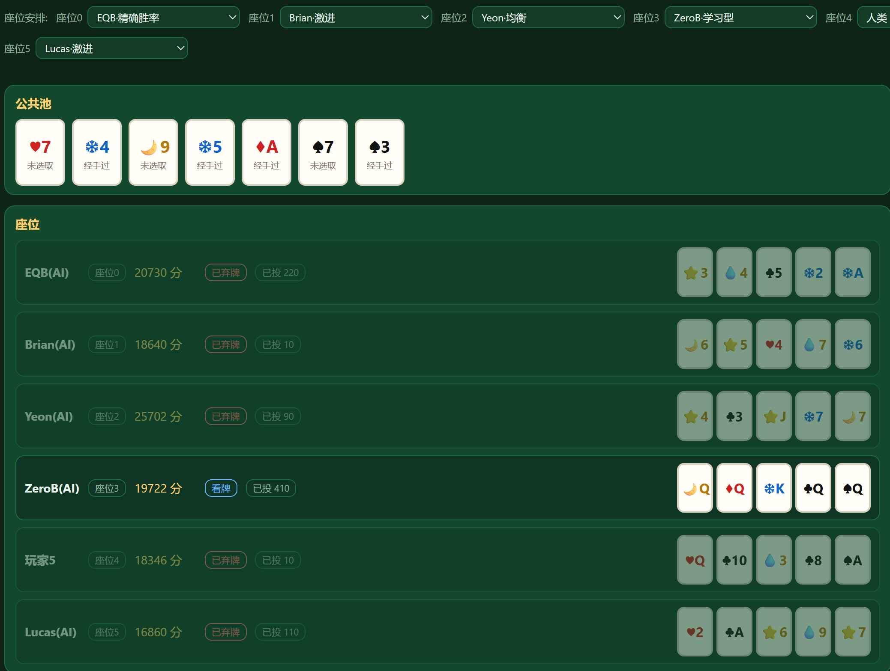

# 五张牌炸金花变体 · 积分制规则引擎

纯积分制娱乐游戏引擎(104 张牌 / 8 花色 / 4 色系),TypeScript + Node.js,**零第三方依赖**;核心引擎与 UI 分离,费用 / 上限 / 阈值 / 牌型排序全部可配置,并附带一个现成的 **AI 擂台**。

[](https://github.com/FZF525/zhajinhua-ai-arena/actions/workflows/ci.yml)


- 🎴 **规则引擎**:104 张牌(13 级 × 8 花色)/ 12 档牌型 / 闷牌看牌 / 比牌 / 踢牌封锁轮 / 挂起式截胡
- 🧠 **10 个内置 AI**:规则型 3 + 蒙特卡洛 3 + 精确胜率 3 + 自对弈学习 1
- 🏟️ **AI 擂台**:循环赛排名 / 单点基准 / 上帝视角观战 / 时间轴回放 / 对局存档
- ⚡ **零依赖零构建**:Node ≥ 22.18 直接跑 `.ts`,clone 完 10 秒内能跑测试
- 📊 **诚实实测**:包括失败结论 —— "算得最准"的 AI 排名垫底,原因写在文档里

```bash
git clone https://github.com/FZF525/zhajinhua-ai-arena.git && cd zhajinhua-ai-arena
node src/cli.ts --ai=human,Sam,May     # 命令行:你 + 2 个 AI
node web/server.ts                     # 浏览器:玩 / 观战 / 回放
node examples/tournament.ts 3 5        # 10 个 AI 循环赛排名
```



> **合规声明**:本项目为纯积分娱乐,不涉及真钱,不提供充值 / 提现 / 现金兑换 / 抽水,也不支持真钱模式。

---

### English summary (TL;DR)

A **zero-dependency TypeScript engine** for a *pure-scoring* (no real money) 5-card **Zha Jin Hua**
variant — 104 cards (13 ranks × 8 suits, 4 colour families), **12 hand tiers**, deferred intercepts,
kick/blockade rounds, head-to-head compares — plus a ready-made **AI arena**.

- **No build, no `npm install`**: Node ≥ 22.18 runs the `.ts` files directly (`npm test`).
- **10 built-in agents**: 3 rule-based personas, 3 Monte-Carlo bots, 3 exact-equity bots, 1 self-play learned agent.
- **Add your own AI in ~20 lines**: implement `(state, rng) => Action`, register it, and it shows up in
  the CLI, the web UI, the benchmark and the round-robin tournament — see [CONTRIBUTING.md](./CONTRIBUTING.md).
- **Spectate & replay**: god-view live play, scrubbable timeline, auto-saved replays (~25 KB/match,
  replayed by re-simulating from the seed — zero frame caching, ~0.5 ms/frame).
- **Honest benchmarks included**, negative results too: the most "accurate" equity bot finished *last*
  (see the arena section). In this variant, discipline beats deep calculation.

```bash
git clone https://github.com/FZF525/zhajinhua-ai-arena.git && cd zhajinhua-ai-arena
node src/cli.ts --ai=human,Sam,May     # 你坐 0 号,其余交给 AI
node web/server.ts                     # 浏览器:玩 / 观战 / 回放(默认 http://127.0.0.1:8787)
node examples/tournament.ts 3 5        # 10 个 AI 循环赛排名
```


### 它是什么、不像什么(命名与定位)

常被问"这是不是炸金花版德州扑克"。**决策内核确实是混合体,但成牌规则不是德州** —— 本变体的公共池是**共享市场**,不是公共牌:

| | 传统炸金花 | 德州扑克 | **本变体** |
| --- | --- | --- | --- |
| 手牌 | 3 张 | 2 张 + 5 张公共牌 | **5 张,自己就成一副牌** |
| 公共池 | 无 | 翻牌/转牌/河牌,**必须与手牌组合成牌** | **7 张共享池:花钱换入换出,完全不参与成牌** |
| 闷牌 | 有(核心) | 无 | **有**(闷牌只付半注,看牌后费率翻倍) |
| 比牌 | 有(核心) | 无(只有摊牌) | **有**(付 2×rate×M 点名单挑,输者直接出局) |
| 踢牌 / 截胡 | 无 | 无 | **有**(踢掉池中一张并补一张暗牌;邻居可截胡别人刚换走的牌) |
| 下注结构 | 单轮加注为主 | 4 条街 | **多轮 + 注码梯度递增 + 封顶后强制摊牌** |
| 决策内核 | 心理博弈 | 赔率与范围 | **两者叠加**:闷牌信息差 + 池市场 + 精确赔率 |

**一句话定位**:炸金花的壳(闷牌 / 比牌 / 看牌),德州的脑(多轮赔率、位置、胜率计算),外加一个原创的"7 张共享池市场"。

> **命名建议**:仓库名保留 `zhajinhua`(这是搜索关键词 + 规则骨架),但**描述里写"变体",不要写"德州扑克"** —— 否则新用户会按德州的预期来找"公共牌成牌",一进来就发现对不上。推荐描述:
> `A pure-scoring Zha Jin Hua variant with a shared 7-card exchange pool, 12 hand tiers and 10 built-in AIs.`

## 环境要求

- **Node ≥ 22.18**(实测 v24.19)。检查:`node --version`
- **不需要 `npm install`**:Node 22.18+ 可原生剥离类型直接运行 `.ts`,测试用内置 `node:test`。
- 低版本 Node 需加 `--experimental-strip-types`,或用 `npx tsc` 先编译成 `.js`(代码只用了可擦除语法,编译无痛)。

## 三种用法

### ① 直接玩(交互式热座)

~~~bash
cd zhajinhua
node src/cli.ts
~~~

命令:`v`看牌 `c`跟注 `r`加注 `f`弃牌 `b <座位>`比牌 `e <拿> <给>`换牌 `k <序号>`踢牌 `t <给>`换走暗牌 `p`不换 `i <给>`截胡 `d`放弃截胡 `rt <拿>`补换 `s`放弃补换 `q`退出。
开局会打印随机种子,记录它可完整复现同一局。

### ② 看它跑(非交互)

~~~bash
node src/cli.ts --demo --seed=7          # 打印一局完整事件流 + 结算
node src/cli.ts --selftest --games=40    # 40 组自动对战,校验守恒与不变量
node examples/quickstart.ts              # 最小 API 用法(逐步推进)
node examples/custom-config.ts           # 配置化 + 200 场批量模拟统计
node examples/balance-probe.ts           # 平衡性探针:<场数> <局数上限> <初始积分> <阈值>
node examples/threshold-probe.ts         # 阈值扫描:多大领先能在多少局内决出
node examples/ante-probe.ts              # 底注扫描:<场数> <局数上限> <底注...>
node examples/mix-probe.ts               # 底注 × 阈值 二维网格
node examples/scale-probe.ts             # 费用表整体等比缩放 + 等价性对照
~~~

### ③ Web UI(热座,零依赖无构建)

~~~bash
node web/server.ts                # 打开 http://127.0.0.1:8787
node web/server.ts --port=9000    # 换端口
~~~

- **服务端按可见性裁剪后再下发**:别人的手牌永远是 null;**闷牌者连自己的手牌都拿不到**(必须先点"看牌"),所以前端无从作弊 —— 这条有单测盯着(test/view.test.ts WEB-01~WEB-05)。
- 每个可用动作都**带着费用**一起下发(跟注 40 分 / 踢牌 320 分…),客户端只负责画。
- 页面上可切人数与分场(自适应 / 小分场 ×10 / 大分场 ×25)、看公共池与座位、点牌选牌、看日志与结算。
- 有**遮屏**按钮:轮到谁就把设备递给谁,交接时自动遮屏,适合面对面的热座玩法。
- 座位由**服务端判定**(客户端传什么 seat 都会被覆盖),避免越权操作。
- 操作流(尽量少点击):**换牌 = 点公共池的牌 → 点自己手牌的牌,立即成交**;**踢牌 = 点公共池的牌**即可;**截胡 / 换走暗牌 = 点自己手牌的牌**;**加注 / 比牌**按按钮再选对象。选中态有高亮,非法牌会置灰。
- **截胡横幅**:只要场上有待截胡,页面顶部就会显示"谁换入了哪张牌、归谁在自己的回合决定";轮到你时横幅变金色,若你还在闷牌会提示"先点看牌"。

### ④ 当库用(把引擎接进自己的程序)

~~~ts
import { makeConfig } from "./src/config.ts";
import { createGame, player } from "./src/state.ts";
import { apply, advance } from "./src/engine.ts";
import { legalActions } from "./src/validate.ts";

const game = createGame(makeConfig({ players: { startPoints: 20000 } }), ["甲", "乙"], 2024);
advance(game);                                   // 底注 / 发牌 / 翻公共池
console.log(legalActions(game));                 // ["FOLD","CALL","RAISE","VIEW_HAND","KICK"]
const r = apply(game, { type: "CALL", seat: game.turn.seat! });
if (!r.ok) throw new Error(r.error!.code);       // 非法动作:状态不变
console.log(r.events);                           // 本次产生的 GameEvent[]
console.log(player(game, 0).hand, game.pool, game.pot);
~~~

要点:

- **入口就三个**:`advance(state)` 推进无需输入的阶段;`legalActions(state)` 查可用动作;`apply(state, action)` 执行并返回 `{ ok, events, error }`。注意 `apply` 会**就地修改** state。
- **随机走 `src/rng.ts`**:同种子 → 同发牌序列,整局可回放(种子 + 动作序列即可复现)。
- `src/bot.ts` 的 `randomBot(state, rng)` 是接入自定义 AI 的模板:只读公共信息 + 合法动作。
- 引擎不决定"谁的牌给谁看":可见性由调用方控制(CLI 只打印当前行动者的手牌)。


## AI 玩家(10 个角色)

| 角色 | 风格 | 类型 | 特点 |
| --- | --- | --- | --- |
| **Baozi** | 保守 | 规则型 | 两对以上才跟,葫芦才加;最会省钱 |
| **Sam** | 标准 | 规则型 | 一对以上可跟,三条加注;通用参照物 |
| **Lucas** | 激进 | 规则型 | 高牌也跟,爱加注爱比牌,还爱诈唬 |
| **May** | 稳健 | 蒙特卡洛 | 24 次采样,风险偏好最低 |
| **Yeon** | 均衡 | 蒙特卡洛 | 16 次采样,中等风险 |
| **Brian** | 激进 | 蒙特卡洛 | 10 次采样 + 高风险偏好,敢赌 |
| **EQB** | 精确胜率 | 胜率型 | 直接算摊牌胜率再按赔率决策(校准版) |
| **EQBfast** | 精确胜率(快) | 胜率型 | 同上但采样 1/6,用来量化"算得多准值多少分" |
| **EQBnaive** | 精确胜率(未校准) | 胜率型 | 纯赔率门槛 + 上来就看牌,对照组 |
| **ZeroB** | 学习型 | 自对弈 RL | 表格型 Q 学习,自己跟自己打 7600 手学出来的 |


~~~bash
node src/cli.ts --players=3 --ai=human,Sam,May   # 你坐 0 号,其余交给 AI(--ai 逗号分隔,human/-/空 = 人类)
node src/cli.ts --ai=May,Yeon,Brian    # 纯 AI 对战观战
node examples/ai-bench.ts 10 6         # 强度对比:<场次> <每场局数>
~~~


**局间暂停与结算**:每局结束会停下来,右侧「本局结算」面板给出:结束原因(其他人都弃牌 / 摊牌 / 平局分量)、底池、赢家、**每家本局净收支**(绿正红负)、以及**公开的手牌 + 牌型**(如 `葫芦 [4 8]`)。摊牌那一瞬全部手牌公开;弃牌者按 v1.7 亮牌规则公开;没摊牌的赢家不亮牌(规则如此),但**整场结束时会全部公开**。看完点「下一局 ▶」继续,整场结束时该按钮消失、点「新开一场」再来。想回到"一局接一局不停顿"的旧行为:环境变量 `ZHJ_NO_PAUSE=1` 启动服务端。

**视角规则**:单人局里视角**锁定在你自己的座位** —— 轮到 AI 时不会因为"系统认为你在跟 AI 的视角走"而把它的牌发给你(只有它弃牌亮牌、或本局结算后才公开)。多人同屏(≥2 个真人座位)才跟随行动者,这才是热座该有的行为。**本局结算时手牌全部摊开**,谁用什么牌赢的一目了然。

**热座遮屏默认关闭**(页头可勾选):只有多人同屏轮流玩时才需要自动盖屏;单人打 AI 不再每回合弹窗。需要时也可以随时按「遮屏」手动盖。

**AI 的节奏由前端控制**:服务端提供 `POST /api/step`,一次只推进**一步** AI 动作;页面按 `AI 速度`(慢 1.4s / 正常 0.7s / 快 0.25s / 瞬间)自己循环调用,所以每一步都看得见 —— 轮到 AI 时座位会高亮并显示"XX 刚刚:加注到 M=2 20 分",日志同步滚动,轮到你了才回到操作区。想快点看结果就把速度拨到"瞬间"。

**人数 / 分场 / 座位怎么改**:页头选人数(2~6)与分场,座位行给每个座位选「人类」或某个 AI,然后点 `新开一场`。改了设置没重开时,按钮会变成高亮的「按上面设置新开一场」提醒你。**首屏会按上次用的设置直接开一局**(存在浏览器 localStorage 里),不会固定在 3 人场。命令行则用 `--players=N` 跳过人数提问:

~~~bash
node src/cli.ts --players=5 --ai=human,Sam,May,Brian,Yeon
node src/cli.ts --players=2 --ai=May,Brian      # 纯 AI 单挑,当观战看
~~~

Web 界面上每个座位都能选角色(默认:你坐 0 号,其余 Sam),AI 的回合由服务端自动推进并把动作写进日志。

**蒙特卡洛 AI 是怎么想的**(`src/env.ts`):

1. **确定化**:对手手牌 + 牌堆是未知信息 → 每个 rollout 重新随机分配一次(采样一个"世界",自己的手牌与公共池不动);
2. **rollout**:在这个世界里用规则型策略把本局打完(结算即停,取净收益);
3. **比较候选**:对 FOLD / CALL / RAISE / COMPARE(每个对手)各跑 N 次,取期望最高者,并按风险偏好加权胜率;
4. **独立随机源**:模拟用 `rng.clone()`,**绝不推进真实牌局的随机序列**(有用例盯着)。

单次决策约 **47ms**(10~24 次采样),浏览器里感知不到卡顿。


### EQB(精确胜率)与 ZeroB(自对弈学习)

**EQB 怎么算**:先算出"我看不到的牌"(牌堆 + 存活对手手牌 + 别人踢的暗牌),把这些牌随机分给对手,比摊牌的期望底池份额 —— 1200 次采样约 3ms。已知信息用满:自己的牌、7 张公共池明牌、**已弃牌者亮出的牌**(v1.7 亮牌规则在这里直接变成算力优势)。

**ZeroB 怎么学**:把局面抽象成有限状态(牌力档 × 跟注价 × 对手数 × 轮次 × 是否封顶 ≈ 1560 个),自我对弈打牌,每手结束用"本局净收益"做回报反向传播(Q-learning)。辅助动作(看牌/换牌/踢牌/截胡)借用启发式,只学主决策。训练命令:

~~~bash
node examples/zerob-train.ts 8 800 8 6 2     # 代数 每代手数 评估场次 评估局数 训练人数
~~~
训练结果存在 `data/zerob.json`,Web 里选中 ZeroB 即用它;没训练过时会退化为 EQBfast(不会瞎打)。

**实测**(单挑对手固定 Sam,10 场 × 6 局,数值 = 每场平均积分差):

| 角色 | Baozi | Brian | Yeon | May | ZeroB | Lucas | random | EQBfast | EQBnaive | EQB |
| --- | --- | --- | --- | --- | --- | --- | --- | --- | --- | --- |
| 分/场 | **+654** | +304 | +266 | +197 | +85 | -80 | -125 | -141 | -215 | **-528** |

**为什么"算得最准"的 EQB 反而垫底?** 因为胜率算得对,不等于决策规则对:

1. **只算单次摊牌,没算后续轮次**:这个变体的注码是逐轮递增的,`equity > 跟注价` 会一路成立到封顶 → 变成"跟到底的提款机";
2. **放弃闷牌折扣**:闷牌只付一半注,而"上来就看牌"要多付一倍;
3. **忽略换牌/踢牌/截胡**:对手可以改善手牌,静态胜率会系统性高估;
4. **加注门槛按胜率定**:单挑中位数手牌对随机手牌胜率就接近 50%,`equity ≥ 0.62 就加注` 会疯狂加注 —— 而这个变体恰好惩罚乱加注(见 Baozi 为什么最强)。

**反过来说**:把这些赔率/胜率信息交给**学出来的策略**(ZeroB),成绩就是正的(+85),还打赢了规则型里的 Lucas。也就是说 —— **"会算"是必要的,但"从算出来的数到动作"这一步,学习比手写规则更靠谱。**

**强度实测**(双人单挑,对手固定 Sam,10 场 × 6 局,数值 = 每场平均积分差):

| 角色 | Baozi | Brian | Yeon | May | Lucas | random |
| --- | --- | --- | --- | --- | --- | --- |
| 分/场 | **+654** | +304 | +266 | +197 | -80 | -125 |

6 个 AI 全部打得过随机策略;**单挑里最紧的 Baozi 最强**(这个变体跟注便宜、阈值差大,乱加注会被惩罚)。样本较小(每格 60 局),±100 分属噪声区间,想更准就加大 `examples/ai-bench.ts` 的参数。

**关于强化学习**:暂时没上,但接口已经留好 —— `src/env.ts` 就是 Gym 风格的现成环境(纯函数、确定性、可克隆、可采样),`bot.ts` 是策略模板。要不要上第三阶段(自对弈 RL)取决于你是否需要"AI 压着人打",工程量比 UI 大一个量级。


## 观战 / 回放

**存档位置**:`<项目根>/data/replays/*.json`(可用环境变量 `ZHJ_REPLAY_DIR` 改)。一局只存 `{种子, 配置, 玩家, 动作序列}` —— 实测:

| 对局 | 文件 | 内容 |
| --- | --- | --- |
| 3 人 / 20 局 | 20 KB | 364 个动作 |
| 4 人 / 20 局 | 25 KB | 441 个动作 |

- **自动存档**:整场结束(阈值/破产/局数上限)自动存一份;也可以随时点「保存本场」
- **容量控制**:只保留最近 50 份(`ZHJ_REPLAY_KEEP` 可调),`data/` 已进 `.gitignore`
- **为什么放服务端而不是浏览器**:磁盘无限、换浏览器/清缓存不丢、能直接把 json 发给别人复现、CLI 与 Web 共用同一目录

**回放怎么用**:点「回放」→ 下拉选一场 → 时间轴出现了:

| 控件 | 作用 |
| --- | --- |
| ◀ ▶ / ▶▶ 播放 | 上一步 / 下一步 / 自动播放(速度跟随页头「AI 速度」) |
| 拖动条 | 直接跳到任意一步 |
| 跳到事件… | 一键跳到 踢牌 / 截胡 / 比牌 / 收暗牌(实测一局有 100+ 个) |
| 下载 / 删除 | 导出 json / 删掉这条存档 |
| 退出回放 | 回到实时对局 |

回放是**上帝视角**:所有人手牌、公共池全部暗牌都看得见。

**观战**:把页头「上帝视角」勾上,再把所有座位都设成 AI,点「新开一场」—— 就是直播间,AI 每一步按你设的速度走。

**内存**:回放**不缓存任何帧**,每次跳转都从种子重算(实测 **0.48 ms/帧**;连续拖 30 次含 HTTP 往返共 123 ms),所以常驻内存只有"当前一帧"约 20 KB + 录制文件 20~35 KB。相比之下"每步存一帧"的实现要 7.6 MB/局(20 局就 150 MB)——这就是为什么这样实现。见 `examples/memory-probe.ts`。

相关接口:`POST /api/replay/save`、`GET /api/replays`、`GET /api/replay/load?file=`、`GET /api/replay/frame?file=&step=`、`DELETE /api/replay?file=`、`GET /api/state?god=1`、`POST /api/step {god:true}`。

## 目录结构

~~~
zhajinhua/
  spec.md               规则规格书 v1.1(12 档排序、费用、状态机、校验表、边界清单、用例清单、实现索引)
  README.md             本文件
  src/
    cards.ts   rng.ts   evaluator.ts   config.ts     # 牌堆 / 随机 / 12 档判定 / 配置(含分场档位)
    state.ts   costs.ts validate.ts    engine.ts     # 状态与不变量 / 费用 / 校验 / 状态机
    bot.ts     cli.ts   format.ts                    # 随机 bot / 热座 CLI / 事件文案
    env.ts                                           # AI 环境:动作枚举 / 确定化 / rollout / MC 评估
    replay.ts  store.ts  version.ts                   # 回放内核 / 对局存档 / 版本标记
    ai/
      heuristic.ts                                   # Baozi / Sam / Lucas
      montecarlo.ts                                  # May / Yeon / Brian
      remote.ts                                      # 外部 AI(LLM)入口:视图隔离 + 动作校验
      equity.ts                                      # EQB(精确胜率)
      learning.ts                                    # ZeroB(自对弈 Q 学习)
      index.ts                                       # 角色注册表
  web/
    server.ts  view.ts                               # 零依赖 HTTP 服务 / 可见性裁剪
    public/    index.html  app.js  style.css         # 热座前端(原生 JS,无构建)
  test/
    deck.test.ts  evaluator.test.ts  exhaustive.test.ts  engine.test.ts
  examples/
    quickstart.ts      custom-config.ts
~~~

## 规则摘要

**牌堆**:13 点数 × 8 花色 = 104 张,无大小王;8 花色分 4 色系(红 ♥♦ / 黑 ♠♣ / 蓝 ❄💧 / 金 ⭐🌙)。

**12 档牌型**(同花按**花色**、同色按**色系**,两者并存):

| 序 | 牌型 | 判定 | 组合数 | 概率 |
| --- | --- | --- | --- | --- |
| 1 | 同花顺 | 同花色 + 连续 | 80 | 0.000087% |
| 2 | 五条 | 5 张同点数 | 728 | 0.000792% |
| 3 | 同色顺 | 同色系 + 连续,非同花色 | 1,200 | 0.001305% |
| 4 | 同花 | 同花色,非连续 | 10,216 | 0.011109% |
| 5 | 四条 | 4 + 1 | 87,360 | 0.094995% |
| 6 | 葫芦 | 3 + 2 | 244,608 | 0.265987% |
| 7 | 同色 | 同色系,非同花色、非连续 | 251,624 | 0.273616% |
| 8 | 顺子 | 连续,非同色系 | 326,400 | 0.354927% |
| 9 | 三条 | 3 + 2 散 | 3,075,072 | 3.343832% |
| 10 | 两对 | 2 对 + 1 散 | 5,374,512 | 5.844242% |
| 11 | 一对 | 1 对 + 3 散 | 40,909,440 | 44.484905% |
| 12 | 高牌 | 以上皆非 | 41,681,280 | 45.324204% |

组合数为**穷举全部 91,962,520 手牌**的精确统计(合计守恒、稀有度严格单调)。比牌两步:先比 tier,再按 key 字典序;全等即平局、平分底池。

**费用**(全部进底池,不抽水):

| 操作 | 实际费用 | 说明 |
| --- | --- | --- |
| 底注 | 1 分 | 不乘 M |
| 看牌跟注 / 加注 | 2 × M / 2 × 新 M | 闷牌减半 |
| 闷牌跟注 | 1 × M | 闷牌比例 0.5 |
| 换牌 | fees[次数] × M,1 / 3 / 10 | 每人每局最多 3 次 |
| 踢牌 | 8 × M | 每人每局限 1 次 |
| 截胡 | 原换牌费快照 + n(n+1) × M | n = 该牌第几次被截 |
| 比牌 | 2 × 自身 rate × M(看牌 4M / 闷牌 2M) | 输者弃牌退场 |

**关键机制**

- **M(倍数)**:初始 1,加注升 2/4/8/16/32;封顶后再打满 **2 个下注轮**强制摊牌。
- **闷牌**:不能换牌 / 截胡,可踢牌;跟注减半;走完 3 个下注轮后才可盲比;盲比不解除闷牌。
- **踢牌 / 封锁轮**:踢走一张从未被选取的公共明牌,补入一张暗置牌(仅踢牌者可见);行动指针回到踢牌者时封锁轮收束,他可"换走暗牌"(付费 + 占换牌次数 + 失去闷牌 + 不可被截)或"不换"(立即公开)。
- **截胡(挂起式)**:换牌后只挂起一条"待截胡",**不打断回合**;真正可截的时机是**紧邻下家的回合内**,他**可以先看牌再决定**(所以第 1 轮就能截)。同一张牌最多被截 3 次、每局最多 5 次、不能回流给经手人;不选即随回合结束作废。被截者当场收下截胡者放回的那张牌(手牌永远 5 张),想换别的在自己回合正常换牌。
- **弃牌即亮牌**:弃牌后手牌公开给所有人(便于算牌),由 `fold.revealToAll` 控制(默认开;关掉则退化为盖牌)。MC 的确定化会把已亮出的弃牌当已知信息、不再重洗 —— **AI 因此真的在算牌**。
- **比牌平局**:双方都不出局、继续对局;当**全部存活玩家属于同一平局连通分量**时本局结束,平局者瓜分底池。
- **终局(按优先级)**:初始 20000 分。每局结算后依次判断 —— ① 任一玩家 ≥ **40000** → 整场结束(最高分者胜,并列平局);② 任一玩家 ≤ 0 → 破产收场;③ 打满 **maxHands(默认 20 局)** → 按积分排名收场。

## 配置

`makeConfig(patch)` 深度合并默认配置:

~~~ts
const cfg = makeConfig({
  players: { startPoints: 20000 },
  endGame: { winAtOrAbove: 40000, bustAtOrBelow: 0, maxHands: 20 },   // maxHands: null = 不限局数
  fold: { revealToAll: true },                                        // 弃牌亮牌(算牌用),false = 盖牌
  betting: { ladder: [2, 4, 8, 16, 32], postCapRoundsToShowdown: 2 },
  compare: { blindMinBettingRounds: 3 },
  exchange: { fees: [1, 3, 10], maxPerHand: 3 }
});
~~~

可配置:初始积分 / 终局阈值 / 局数上限 / 牌堆模式 / 花色色系映射 / 手牌数 / 公共池张数 / 换牌费用与次数 / 截胡公式参数与上限 / 踢牌费用与次数 / 加注阶梯与封顶后轮数 / 闷牌比例 / 比牌参数 / 平局余数归属 / 12 档排序。

## 验证

| 验证项 | 结果 |
| --- | --- |
| 单元 + 端到端用例 | **84 条(83 通过 / 1 条穷举默认跳过)** |
| 穷举分布回归(H-24) | 91,962,520 手牌逐项等于规格表,合计守恒,约 55 秒 |
| 随机对战 fuzz | 40 组 / 160,000 动作 / 18,338 局,积分守恒 + INV1~INV9 全程成立 |
| CLI 冒烟 | `--selftest` 通过;`--demo` 跑完整局并打印结算 |
| Web UI | `/api/state` / `/api/action` / `/api/new` / `/api/step` / `/api/agents` 已通;可见性与 id 契约 8 条(WEB-01~08)+ 前端静态检查 4 条(HTML-01~04) |

## 分场档位(小分场 / 大分场 / 自适应)

同一套规则,不同"货币刻度" —— 用整表等比缩放实现,机制权重完全不变(下注始终占底池 91%~98%)。

~~~bash
node src/cli.ts --table=small      # 小分场:底注 10 / 跟注 20·10 / 换牌 10-30-100 / 踢牌 80
node src/cli.ts --table=big        # 大分场:底注 25 / 跟注 50·25 / 换牌 25-75-250 / 踢牌 200
~~~

~~~ts
import { makeTableConfig, makeBalancedConfig } from "./src/config.ts";
const small = makeTableConfig("small");       // 固定档位
const custom = makeBalancedConfig(4);         // 按人数自适应(k=25)
~~~

初始 20000 / 阈值 40000 / maxHands 20,每格 20 场:

| 人数 | 小分场 ×10 | 大分场 ×25 |
| --- | --- | --- |
| 2 | 0% 收场(打满 400 局) | 45%(均 326 局) |
| 3 | 40%(均 355 局) | 85%(均 111 局) |
| 4 | 90%(均 248 局) | 100%(均 47 局) |
| 5 | 85%(均 105 局) | 95%(均 15 局) |
| 6 | 90%(均 **47** 局) | 90%(均 **9** 局) |

- **结论:两个档位本身没问题(机制完整),问题是"人数敏感度极大"** —— 同样 ×10,6 人 47 局、2 人打不完,差 8 倍以上。
- **小分场**适合 4~6 人(50~250 局);**大分场**适合 4~5 人(15~47 局);6 人用大分场只 9 局,偏快。
- **2~3 人两档都不够**,要单独放大刻度。

### 按人数自适应(推荐给"人数不固定"的场合)

| 人数 | 推荐 k | 底注 | 实测平均局数 |
| --- | --- | --- | --- |
| 2 | 70 | 70 | 81 局(参考:k=50 → 114 局,k=40 → 205 局) |
| 3 | 40 | 40 | 48 局 |
| 4 | 25 | 25 | 58 局 |
| 5 | 16 | 16 | 33 局 |
| 6 | 10 | 10 | 47 局 |

规律:**底池随人数线性变大,所以让各人数局数相当的 k 大致与人数成反比**。用法:`makeBalancedConfig(playerCount)`。

## 平衡性提示(实测数据)

### ① 核心原则:费用表必须整体等比缩放

底注 / 跟注基准 / 换牌费 / 踢牌费共享同一"货币刻度"。**只放大其中一项(比如只抬底注)不是"放大经济",而是"改比例"** —— 这正是上一轮"底注 125/250/500"实验的问题。

引擎提供了工具:

~~~ts
import { scaleEconomy } from "./src/config.ts";
const cfg = scaleEconomy(makeConfig({}), 10);   // 整表 ×10
// 底注 1→10、跟注 2·1→20·10、换牌 1-3-10→10-30-100、踢牌 8→80,比例分毫不动
~~~

### ② 实测:等比放大 k 倍 ≡ 把初始积分缩小 k 倍

初始 20000 / 阈值 40000,每格 20 场,400 局上限:

| 缩放 | 底注 / 跟注 / 换牌 / 踢牌 | 6 人收场 | 3 人收场 | 6人每局底池 | 下注占比 |
| --- | --- | --- | --- | --- | --- |
| ×1 | 1 / 2·1 / 1-3-10 / 8 | 0%(打满) | 0%(打满) | 334 | 98% |
| ×2 | 2 / 4·2 / 2-6-20 / 16 | 5%(378 局) | 0%(打满) | 660 | 98% |
| ×5 | 5 / 10·5 / 5-15-50 / 40 | 100%(174 局) | 5%(351 局) | 1,590 | 98% |
| ×10 | 10 / 20·10 / 10-30-100 / 80 | **100%(47 局)** | 45%(299 局) | 3,257 | 98% |
| ×25 | 25 / 50·25 / 25-75-250 / 200 | **100%(9 局)** | 90%(78 局) | 8,785 | 98% |

对照组(原费用表 + 直接缩小筹码):

| 初始 / 阈值 | 6 人收场 | 3 人收场 | 每局底池 | 下注占比 |
| --- | --- | --- | --- | --- |
| 20000 / 40000 | 0%(打满) | 0%(打满) | 334 | 98% |
| 2000 / 4000 | 100%(42 局) | 55%(261 局) | 338 | 98% |
| 800 / 1600 | 100%(8 局) | 100%(73 局) | 370 | 98% |

**×10 ↔ 2000/4000、×25 ↔ 800/1600,两行几乎重合 —— 数学上它们本就是同一件事。** 而且两种情况里下注都占底池 94%~98%,所有机制权重完好。

### ③ 错误示范:只放大底注会吞掉玩法

6 人局,只把底注从 1 抬到 125 / 250 / 500(其余费用不动):

| 底注 | 6人每局底池 | 其中底注 | 其中下注 | 下注占比 | 阈值收场 |
| --- | --- | --- | --- | --- | --- |
| 1 | 338 | 6 | 332 | 98% | 0% |
| 125 | 1,082 | 750 | 332 | 31% | 3% |
| 250 | 1,795 | 1,500 | 295 | 16% | 63% |
| 500 | 3,220 | 3,000 | 220 | **7%** | 97% |

收场是变快了,但底注吃掉 84%~93% 的底池,单次跟注(最大 64 分)变成零头 —— 闷牌 / 加注 / 换牌 / 截胡 / 踢牌全部沦为装饰。**这组数据只能证明"比例被破坏会怎样",不能当作调参依据。**

### ④ 推荐配置(初始 20000 / 阈值 40000)

| 目标 | 配置 |
| --- | --- |
| 6 人约 50 局、机制完整 | **scaleEconomy(cfg, 10)** —— 底注 10 / 跟注 20·10 / 换牌 10-30-100 / 踢牌 80 |
| 6 人约 10 局(快节奏) | **scaleEconomy(cfg, 25)** —— 底注 25 / 跟注 50·25 / 换牌 25-75-250 / 踢牌 200 |
| 3~4 人也要快 | 叠加调小阈值差(阈值 22000 起)或再放大 k |
| 单挑 | 单独配:阈值差 ≤ 1000,或交给 maxHands |
| 数值想"小" | 等价写法:初始 2000 / 阈值 4000 或 800 / 1600,费用表不动 |

### ⑤ 调参的两个正确旋钮

1. **整体等比缩放费用表**(推荐):机制权重不变,等价于缩放初始积分;
2. **调阈值差**:"多大领先算赢";收场局数约与阈值差成**平方**关系(差 1000 → 6 人 15 局;2000 → 50 局;5000 → 230 局)。

单独调底注、单独调换牌费都属于第 ③ 类,会破坏机制平衡。

自测命令:

~~~bash
node examples/scale-probe.ts 20 400                  # 整表缩放 + 等价性对照
node examples/ante-probe.ts 30 400 1 10 125 250 500  # 底注扫描(错误示范)
node examples/mix-probe.ts                           # 底注 × 阈值 网格
node examples/threshold-probe.ts                     # 阈值扫描
node examples/balance-probe.ts 80 400 2000 4000      # <场数> <局数上限> <初始积分> <阈值>
~~~


### 加入你的 AI(约 20 行代码)

```ts
// 1) 新建 src/ai/mybot.ts
import type { GameState } from "../state.ts";
import type { Policy } from "../env.ts";
import { enumerateActions } from "../env.ts";

export const makeMyBot = (): Policy => (state: GameState, rng) => {
  const acts = enumerateActions(state);          // 当前全部合法动作(含"选哪张牌")
  return acts.find((a) => a.type === "CALL") ?? acts[0];
};
```

2. 在 `src/ai/index.ts` 里把 `"MyBot"` 加进 `AI_NAMES` / `AGENTS` / `makeAgent`
3. `npm test` 跑一遍(欢迎顺手加一条自己的用例)
4. `node examples/tournament.ts 5 6` 看排名,把成绩写进 PR 说明

**公平竞赛规则**(审查时会检查):

- **不许偷看**:不得读取 `state.players[别人].hand` / `state.deck` / 未公开的暗牌 —— 只能用
  `enumerateActions()` 与 `buildView()` 给你的信息。(未来的 RemoteAgent 会在服务端强制隔离。)
- **只动自己的动作**:不得修改 `state`;返回的必须是 `enumerateActions()` 里的合法动作。
- **可复现**:随机数只用传入的 `rng`,不要用 `Math.random()` —— 这样同种子可复现、可回放。
- 非法动作 / 超时 / 越权读牌 = 判负。


## 让 LLM 上场(外部 AI 入口)

任何外部模型都能占一个座位来打 —— 包括 ChatGPT / DeepSeek / 通义,或者本地跑的 Ollama。

**设计要点**:

- **公平隔离**:发给模型的是 `buildView(state, true, { viewer: seat })` 的裁剪结果 —— 它**看不到**别人的手牌、牌堆、未公开暗牌(有 `RM-01` 用例专门盯着这句话)。
- **协议**:OpenAI 兼容的 `/v1/chat/completions`;模型只需回一个 JSON,如 `{"action":"CALL"}` 或 `{"action":"EXCHANGE","takeCardId":"HEART-2","giveCardId":"SPADE-7"}`。
- **违规有账**:超时 / 解析失败 / 非法动作 → 记一笔并走兜底(默认弃牌),结果里打印违规次数,不做"悄悄帮它圆过去"。
- **免费可测**:`examples/mock-llm.ts` 是本地 mock,零成本跑通整条链路。

```bash
# 终端 1:本地 mock(免费,不联网)
node examples/mock-llm.ts

# 终端 2:让 LLM 座位去跟内置 AI 打
node examples/llm-duel.ts --vs=Sam,May --hands=6
node examples/llm-duel.ts --vs=Baozi,Brian --hands=8 --log=20       # 打印每步决策与原话

# 接真模型(任意 OpenAI 兼容服务)
LLM_ENDPOINT=https://api.deepseek.com/v1/chat/completions LLM_MODEL=deepseek-chat LLM_API_KEY=sk-xxx \
  node examples/llm-duel.ts --vs=Sam,May --hands=6

# 本地 Ollama(完全免费、不联网)
LLM_ENDPOINT=http://127.0.0.1:11434/v1/chat/completions LLM_MODEL=qwen2.5:7b \
  node examples/llm-duel.ts --vs=Sam,May --hands=6
```

**实测**(mock 对手 Sam,May,4 局):`LLM 决策 68 次,违规 0 次,平均 31ms/步`,对局自动存档、可回放。

**成本参考**:一手牌约 10~30 次调用,prompt 约 400 token;用本地模型是 0 成本,云 API 一手牌大约几分钱。

## AI 擂台(斗蛐蛐)

任何 AI 只要实现 `(state, rng) => Action`、放进 `src/ai/` 并在 `index.ts` 注册,就自动出现在 CLI、Web 座位下拉、`/api/agents`、擂台上。

| 想干嘛 | 命令 |
| --- | --- |
| 循环赛排名 | `node examples/tournament.ts 3 5`(每人场次 / 每场局数,可选参赛名单) |
| 单点基准 | `node examples/ai-bench.ts 10 6`(对手固定 Sam) |
| 现场观战 | Web:所有座位选 AI + 勾「上帝视角」+ AI 速度调慢 |
| 复盘 | 每场自动存档,回放可拖时间轴、跳到踢牌/截胡/比牌 |
| 控制变量 | 同种子 + 每场轮换座位,零和可对账 |

**实测一次**(10 位选手,每对 3 场 × 5 局,共 47s):

| 排名 | 角色 | 净胜分 | 胜-负-平 |
| --- | --- | --- | --- |
| 1 | Baozi(保守规则型) | +4163 | 7-2-0 |
| 2 | Brian(激进 MC) | +2136 | 8-1-0 |
| 3 | Yeon(均衡 MC) | +1324 | 5-4-0 |
| 4 | ZeroB(学习型) | +596 | **9-0-0** |
| 5 | May(稳健 MC) | +247 | 5-4-0 |
| 6 | Sam(标准规则型) | -437 | 3-6-0 |
| 7 | Lucas(激进规则型) | -530 | 2-7-0 |
| 8 | EQBnaive | -1179 | 2-7-0 |
| 9 | EQBfast | -2089 | 4-5-0 |
| 10 | EQB(精确胜率) | -4231 | 0-9-0 |

ZeroB 9 战全胜但净胜分不高(都是小胜);Baozi 依旧最强。每对只打 3 场,名次看量级。

## ZeroB 的 A/B 实验:胜率特征没帮上忙

把「精确胜率分桶」替换掉「牌力档」当强度特征,同样 6400 手自对弈:

| 特征 | vs Sam(10 场 × 6 局) | 访问到的状态数 | 训练手数 |
| --- | --- | --- | --- |
| 牌力档(12 档) | **-20 分/场** | 92 | 6400 |
| 精确胜率(5 桶) | -60 分/场 | 70 | 6400 |
| 不训练(退化 EQBfast) | -141 分/场 | 0 | 0 |

**结论(诚实版)**:训练确实有用(都明显打赢了不训练的版本),但**换更强的特征在当前预算下没有带来提升** —— 而且在 ±150 分的噪声区间内根本分不出来。真正的问题在于:

- 状态空间 1200~1560,实际只访问了 **70~92 个(约 6%)** —— 训练量远不够;
- 评估每格只有 60 手,噪声比信号大;
- 特征分桶从 12 档降到 5 桶,可能反而丢了信息。

**要验证"胜率特征到底值不值",得先把训练量提到几万手、评估改成固定种子的多轮平均。** 这轮实验的诚实价值是:它证伪了我上一轮"喂进胜率就能提升"的猜测。

## 前端踩坑记录(留个教训)

- **重复 id**:页头的人数控件和桌面上的座位面板一度都叫 `id="players"`。`getElementById` 只返回第一个,于是渲染座位列表的代码每次都把页头控件的选项清空 —— 表现为"人数下拉框空白、座位面板没内容"。现在有 `HTML-01~04` 兜着:id 必须唯一、JS 引用的 id 必须存在。
- **就地修改 + 帧数组**:回放时间轴一度每帧都显示终局,因为 `apply` 是就地修改,重复 push 同一个对象。现在每帧 `cloneState`。
- **原生 select 渲染**:人数最终改成按钮组(`2 3 4 5 6`),不再依赖原生下拉框的折叠态渲染;设置值另有一行纯文本回显。

## 里程碑

- [x] M0 规则定稿(spec v1.1)
- [x] M1 牌堆 + 12 档牌型 + 穷举回归
- [x] M2 费用 / 校验 / 状态机骨架 + 不变量
- [x] M3 换牌 / 截胡链 / 踢牌封锁轮 / 比牌平局
- [x] M4 结算 / 终局(含 maxHands)/ 热座 CLI
- [x] M5 热座 Web UI(零依赖,含可见性裁剪与单测)
- [x] v1.6 截胡改挂起式(第 1 轮可截,热座只交接一次设备)
- [x] M6 AI 玩家(3 规则型 + 3 蒙特卡洛,CLI 与 Web 都能用)
- [x] M7 观战 / 回放 UI(上帝视角 / 时间轴 / 关键事件跳转 / 存档与下载,零缓存重算)
